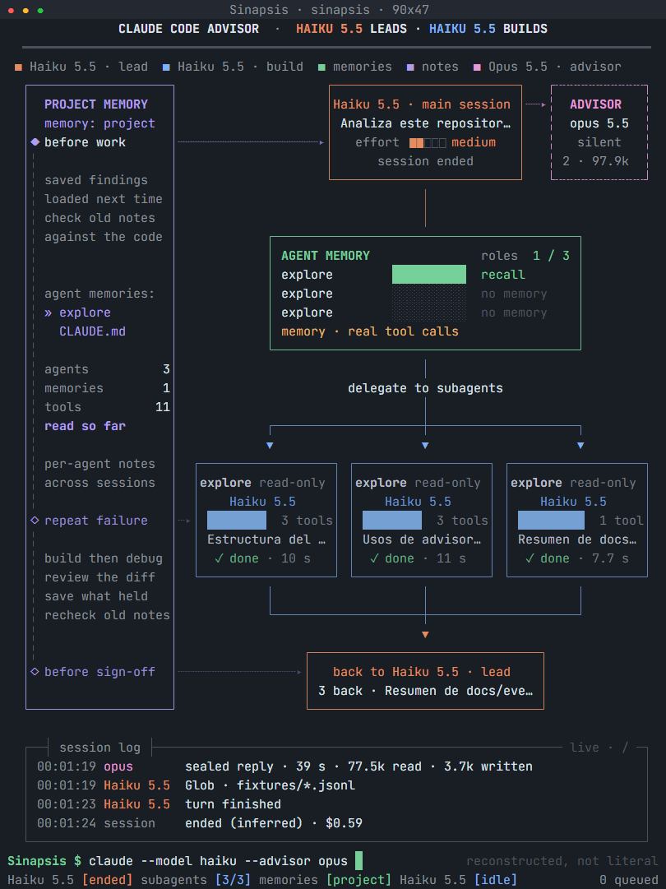
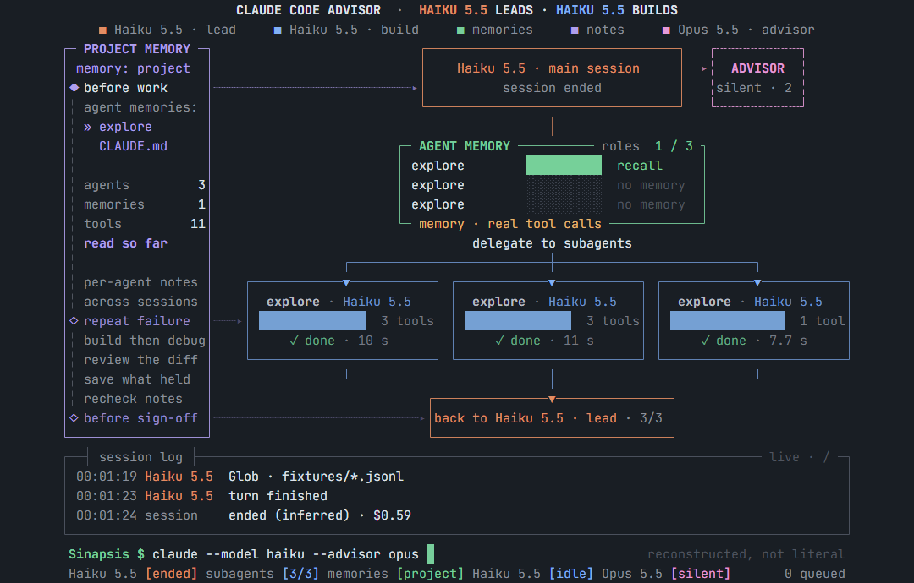

# Sinapsis

Visor animado de consola para el modo advisor de Claude Code. Muestra qué hace cada modelo en una sesión: el modelo
principal ejecutando herramientas, los subagentes trabajando, la memoria que consultan y las consultas al advisor,
con cada evento viajando por el camino que conecta a los agentes.


Corre en la terminal, sin servidor ni navegador. Solo lee los transcripts que Claude Code ya guarda en tu equipo: no
cambia tu configuración ni envía nada a ninguna parte.

## Instalación

Necesitas Node 20 o superior.

```bash
npm install -g github:LuisVillagran/sinapsis
```

Pruébalo sin tener una sesión abierta:

```bash
sinapsis demo
```

## Uso

```text
sinapsis                               Sigue la sesión activa más reciente
sinapsis --session <id>                Sigue una sesión concreta
sinapsis --project <carpeta>           Sigue la sesión más reciente de esa carpeta
sinapsis replay <archivo> [--speed N]  Reproduce un transcript guardado
sinapsis demo [--speed N]              Reproduce la sesión de ejemplo, en bucle y con actividad ilustrativa
sinapsis --help | --version
```

| Opción | Efecto |
| --- | --- |
| `--speed <N>` | Velocidad del replay |
| `--fps <N>` | Fija los cuadros por segundo. Por defecto, entre 30 y 60 con animación según lo que dé la terminal, y mucho menos en reposo |
| `--print-events` | Sin interfaz: imprime los eventos como texto, uno por línea |

| Tecla | Acción |
| --- | --- |
| `q` o `Ctrl+C` | Salir |
| `espacio` | En replay: pausa |
| `+` y `-` | En replay: velocidad |

Para seguir una sesión, abre Sinapsis en otra ventana mientras usas Claude Code. Si no hay ninguna activa en las
últimas 24 horas, se queda esperando.

### Terminal recomendada

- **Tamaño:** toda la escena, con sus conexiones y paquetes, se ve desde 80x30. Se ajusta a la altura disponible y
  queda como en el diseño original desde 90x46. Entre 80x24 y 80x30 solo se muestra un resumen en texto, con un
  aviso, y por debajo se pide agrandar la ventana. Si la terminal es mayor, la escena se centra.
- **Color:** truecolor, con caída a 256 colores.
- **Fuente:** se recomienda [JetBrains Mono](https://www.jetbrains.com/lp/mono/). La aplicación no puede imponerla.

## Qué se ve



| Elemento | Contenido |
| --- | --- |
| Project memory | Tres hitos con flechas hacia sus destinos, último agente y archivo de memoria, y totales de agentes, memorias, herramientas y errores |
| Sesión principal | Modelo, tarea, effort y lo que está haciendo |
| Advisor | Modelo, estado, consultas y tokens leídos |
| Agent memory | Por cada agente, cuántas veces tocó archivos de memoria y si fue `recall`, `check` o `save` |
| Tarjetas | Cada subagente, su modelo, su descripción, su contador de herramientas y, al terminar, la duración |
| Back to lead | Los resúmenes que los subagentes devuelven al modelo principal |
| Session log | Cada evento, con el tiempo desde el inicio de la sesión |

Cada evento viaja por su camino: una herramienta baja por el tronco o por la rama de su tarjeta, una delegación va
de la sesión principal a la tarjeta, un resumen regresa al lead, una consulta va y vuelve del advisor y una lectura
de memoria sale por la flecha de su hito.

En una ventana normal se ve así, a 120x30:



## Cómo se obtienen los datos

Sinapsis sigue los archivos `.jsonl` de `~/.claude/projects/` (o de `CLAUDE_CONFIG_DIR`, si está definida) y los
archivos de cada subagente en `<sesión>/subagents/`. Los transcripts no tienen un formato documentado: lo que
Sinapsis no reconoce lo ignora, y una versión futura de Claude Code podría cambiar lo que se muestra.

El detalle de cada campo y las mediciones están en [docs/eventos.md](docs/eventos.md).

## Limitaciones

Sinapsis no inventa lo que no sabe. Esto es lo que no puede mostrar:

- **`sinapsis demo` es lo único con datos de ejemplo.** Sus porcentajes, la actividad de `AGENT MEMORY` y parte de sus
  paquetes son ilustrativos, y la pantalla lo rotula. `sinapsis` y `sinapsis replay` solo muestran datos reales.
- **Una consulta al advisor no se ve mientras ocurre.** Consulta y respuesta llegan juntas al disco, cuando termina
  el mensaje. En vivo, la sesión solo dice `working`. Después se reproduce la ida y vuelta, comprimida a entre 1,5 y
  5 segundos, y el log da la duración real. Los hooks de Claude Code tampoco la ven.
- **El consejo está cifrado.** Solo se muestran su duración y sus tokens (`sealed reply · 42 s`).
- **El motivo de una consulta es inferido.** El transcript no lo registra. Se deduce con reglas, como `after errors`
  o `before a plan`, y puede equivocarse.
- **Los subagentes no tienen porcentaje de avance.** En vivo, la barra es indeterminada y lo real es su contador de
  herramientas.
- **La memoria se deduce de los archivos.** Se detecta cuando una herramienta de archivos lee o escribe un archivo de
  memoria, o cuando Claude Code carga `CLAUDE.md` o `MEMORY.md`. No se ven los comandos de consola que lean esos
  archivos, ni se sabe para qué se consultaron: los tres hitos son inferidos. Si los agentes no usan memoria, ese
  panel queda quieto, porque eso fue lo que ocurrió.
- **La memoria por agente (`.claude/agent-memory/`) no se ha observado.** La regla se escribió a partir de la ruta
  esperada y se probó con líneas de prueba, no con una sesión real.
- **`read-only` depende del tipo del subagente** (`Explore` o `Plan`), no de lo que hizo.
- **El fin de una sesión es inferido.** Una sesión puede reanudarse.
- **El comando que se ve abajo es una reconstrucción** a partir de los modelos, no el comando literal.
- **Una terminal no tiene brillo real.** El halo de un panel encendido son fondos tintados por celda.
- **Solo caben tres tarjetas.** Con más subagentes, uno nuevo reemplaza a uno terminado o espera su turno, y la lista
  completa queda en el log.

Sin observar en sesiones reales: subagentes en segundo plano o anidados, y otros formatos de respuesta del advisor.

### Verificado y sin verificar

Las pruebas conectan la aplicación a un emulador de terminal (xterm.js), y se siguió una sesión interactiva real a
120x30. Se desarrolló en Windows 11 con Node 24. **No se ha comprobado en una ventana de terminal real, ni en Linux o
macOS.**

## Desarrollo

Usar Sinapsis pide Node 20. Desarrollarlo pide Node 22.18 o superior, por `tsup` y `vitest`.

```bash
npm install
npm test
npm run bundle
```

`dist/` está en el repositorio porque una instalación global desde git no puede compilar: `npm run bundle` debe
ejecutarse antes de cada commit que toque `src/`, y un test falla si se olvida.

| Herramienta | Uso |
| --- | --- |
| `npx tsx tools/snapshot.ts` | Un frame a PNG |
| `npx tsx tools/strip.ts` | Tira de frames de una animación, con reloj falso |
| `npx tsx tools/times-probe.ts` | En qué momento de un fixture ocurre cada animación |
| `npx tsx tools/gif.ts` | El GIF de este archivo |
| `npx tsx tools/measure.ts` | Tiempo por frame, bytes por segundo y CPU en reposo |
| `npx tsx tools/live-run.ts` | Prueba con una sesión real (lanza `claude -p`, con costo) |

Las capturas y el GIF requieren Chrome instalado. `npm test` no lo necesita.

## Créditos

La idea visual se inspira en una imagen de [@skunzu](https://x.com/skunzu) en X. El diseño actual sigue además otras
imágenes de referencia, de autoría sin confirmar. Sinapsis no publica esas imágenes ni usa sus datos de ejemplo.

## Licencia

[MIT](LICENSE)
