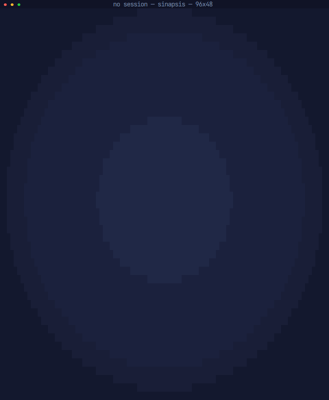
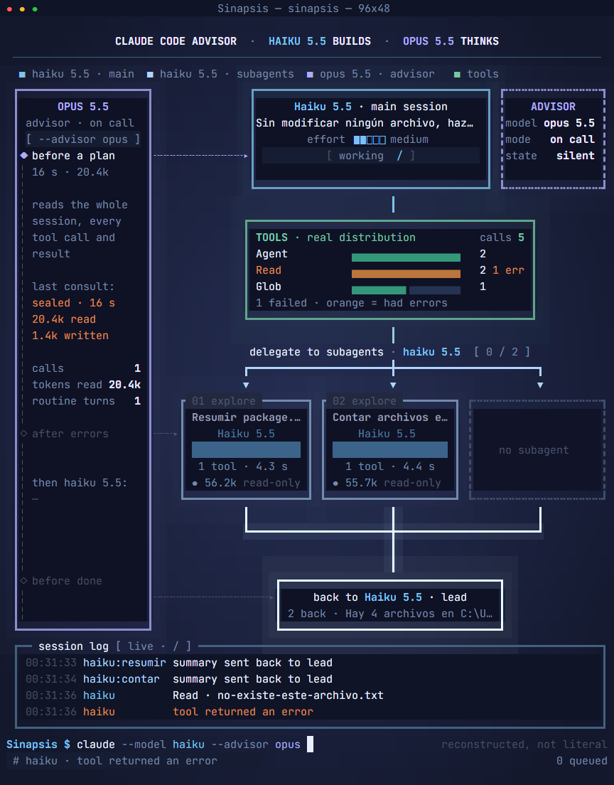

# Sinapsis

Visor animado de consola para el modo advisor de Claude Code. Muestra qué hace cada modelo en una sesión: el modelo
principal ejecutando herramientas, los subagentes trabajando y las consultas al advisor.



Corre en la terminal, sin servidor ni navegador. Solo lee los transcripts que Claude Code ya guarda en tu equipo: no
cambia tu configuración ni envía nada a ninguna parte.

## Instalación

Necesitas Node 20 o superior.

```bash
npm install -g github:LuisVillagran/sinapsis
```

Pruébalo sin tener una sesión abierta:

```bash
sinapsis demo
```

## Uso

```text
sinapsis                               Sigue la sesión activa más reciente
sinapsis --session <id>                Sigue una sesión concreta
sinapsis --project <carpeta>           Sigue la sesión más reciente de esa carpeta
sinapsis replay <archivo> [--speed N]  Reproduce un transcript guardado
sinapsis demo [--speed N]              Reproduce la sesión de ejemplo incluida
sinapsis --help | --version
```

| Opción | Efecto |
| --- | --- |
| `--speed <N>` | Velocidad del replay |
| `--fps <N>` | Fija los cuadros por segundo. Por defecto, entre 30 y 60 con animación según lo que dé la terminal, y mucho menos en reposo |
| `--print-events` | Sin interfaz: imprime los eventos como texto, uno por línea |

| Tecla | Acción |
| --- | --- |
| `q` o `Ctrl+C` | Salir |
| `espacio` | En replay: pausa |
| `+` y `-` | En replay: velocidad |

Para seguir una sesión, abre Sinapsis en otra ventana mientras usas Claude Code. Si no hay ninguna activa en las
últimas 24 horas, se queda esperando.

### Terminal recomendada

- **Tamaño:** el diseño completo pide 96x48. Entre 80x24 y ese tamaño se usa un diseño reducido, y por debajo se
  pide agrandar la ventana. Si la terminal es mayor, el diseño se centra.
- **Color:** truecolor, con caída a 256 colores.
- **Fuente:** se recomienda [JetBrains Mono](https://www.jetbrains.com/lp/mono/). La aplicación no puede imponerla.

## Qué se ve



| Elemento | Contenido |
| --- | --- |
| Panel del advisor | Consultas agrupadas por motivo inferido, duración y tokens de la última, y totales |
| Sesión principal | Modelo, tarea, effort y lo que está haciendo |
| Herramientas | Distribución real de llamadas. En naranjo, las que tuvieron errores |
| Tarjetas | Cada subagente, su modelo, su contador de herramientas y, al terminar, duración y tokens |
| Back to lead | Los resúmenes que los subagentes devuelven al modelo principal |
| Session log | Cada evento, con su hora |

## Cómo se obtienen los datos

Sinapsis sigue los archivos `.jsonl` de `~/.claude/projects/` (o de `CLAUDE_CONFIG_DIR`, si está definida) y los
archivos de cada subagente en `<sesión>/subagents/`. Los transcripts no tienen un formato documentado: lo que
Sinapsis no reconoce lo ignora, y una versión futura de Claude Code podría cambiar lo que se muestra.

El detalle de cada campo y las mediciones están en [docs/eventos.md](docs/eventos.md).

## Limitaciones

Sinapsis no inventa lo que no sabe. Esto es lo que no puede mostrar:

- **Una consulta al advisor no se ve mientras ocurre.** Consulta y respuesta llegan juntas al disco, cuando termina
  el mensaje. En vivo, el panel solo dice `working`. Después se reproduce la ida y vuelta, comprimida a entre 1,5 y
  5 segundos, con la duración real como dato. Los hooks de Claude Code tampoco la ven.
- **El consejo está cifrado.** Solo se muestran su duración y sus tokens (`sealed · 42 s`). El texto que aparece debajo
  es lo que el modelo principal hizo después, con su nombre, y no el consejo.
- **El motivo de una consulta es inferido.** El transcript no lo registra. Se deduce con reglas, como `after errors`
  o `before a plan`, y puede equivocarse.
- **Los subagentes no tienen porcentaje de avance.** La barra es indeterminada, y lo real es su contador de
  herramientas.
- **`read-only` depende del tipo del subagente** (`Explore` o `Plan`), no de lo que hizo.
- **El fin de una sesión es inferido.** Una sesión puede reanudarse.
- **El comando que se ve abajo es una reconstrucción** a partir de los modelos, no el comando literal.
- **Una terminal no tiene brillo real.** El halo de los paneles son fondos tintados por celda.

Sin observar en sesiones reales: subagentes en segundo plano o anidados, y otros formatos de respuesta del advisor.

### Verificado y sin verificar

Las pruebas conectan la aplicación a un emulador de terminal (xterm.js), incluida una sesión real de `claude -p`. Se
desarrolló en Windows 11 con Node 24. **No se ha comprobado en una ventana de terminal real, ni en Linux o macOS.**

## Desarrollo

Usar Sinapsis pide Node 20. Desarrollarlo pide Node 22.18 o superior, por `tsup` y `vitest`.

```bash
npm install
npm test
npm run build
```

`dist/` está en el repositorio porque una instalación global desde git no puede compilar: `npm run build` debe
ejecutarse antes de cada commit que toque `src/`, y un test falla si se olvida.

| Herramienta | Uso |
| --- | --- |
| `npx tsx tools/snapshot.ts` | Un frame a PNG |
| `npx tsx tools/strip.ts` | Tira de frames de una animación, con reloj falso |
| `npx tsx tools/gif.ts` | El GIF de este archivo |
| `npx tsx tools/measure.ts` | Tiempo por frame, bytes por segundo y CPU en reposo |
| `npx tsx tools/live-run.ts` | Prueba con una sesión real (lanza `claude -p`, con costo) |

Las capturas y el GIF requieren Chrome instalado. `npm test` no lo necesita.

## Créditos

La idea visual se inspira en una imagen de [@skunzu](https://x.com/skunzu) en X. Sinapsis no usa esa imagen ni sus
datos de ejemplo.

## Licencia

[MIT](LICENSE)
